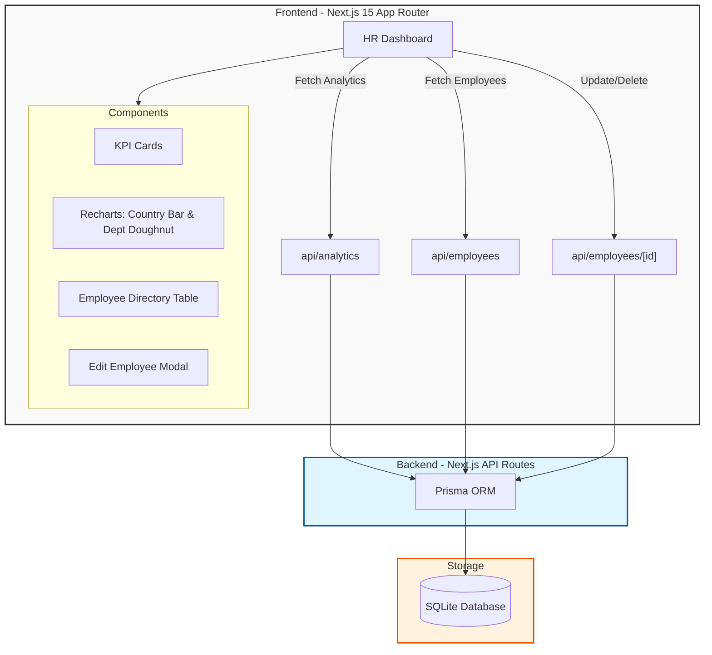

# System Architecture - Employee Salary Management System

This document provides a visual and technical overview of the application's architecture.

## 1. High-Level Architecture Diagram

## 2. Data Flow Detailed

### Analytics Flow (Aggregation)
1. **Request**: Frontend calls `/api/analytics`.
2. **Processing**: 
   - Prisma executes `aggregate` for global totals.
   - Prisma executes `groupBy` for country and department splits.
   - The API layer **normalizes** names (e.g., "india" $\rightarrow$ "India") to merge duplicates.
3. **Response**: JSON data returned $\rightarrow$ Rendered in Recharts.

### Employee Management Flow (CRUD)
1. **Request**: Frontend calls `/api/employees` with query params (`page`, `search`, `country`, `department`).
2. **Processing**: 
   - Prisma filters using `where` clause.
   - Database performs `skip` and `take` for server-side pagination.
3. **Response**: Page of employees + total count $\rightarrow$ Rendered in the Directory Table.

## 3. Technology Stack Summary

| Layer | Technology | Purpose |
|---|---|---|
| **Frontend** | Next.js 15, TypeScript | UI framework and type safety |
| **Styling** | Tailwind CSS | Responsive utility-first design |
| **Visualization** | Recharts | Interactive data charts |
| **Backend** | Next.js API Routes | Serverless functions for data handling |
| **ORM** | Prisma | Type-safe database access |
| **Database** | SQLite | Local, lightweight relational storage |
| **Data Generation** | @faker-js/faker | Generating 10,000 realistic test records |
